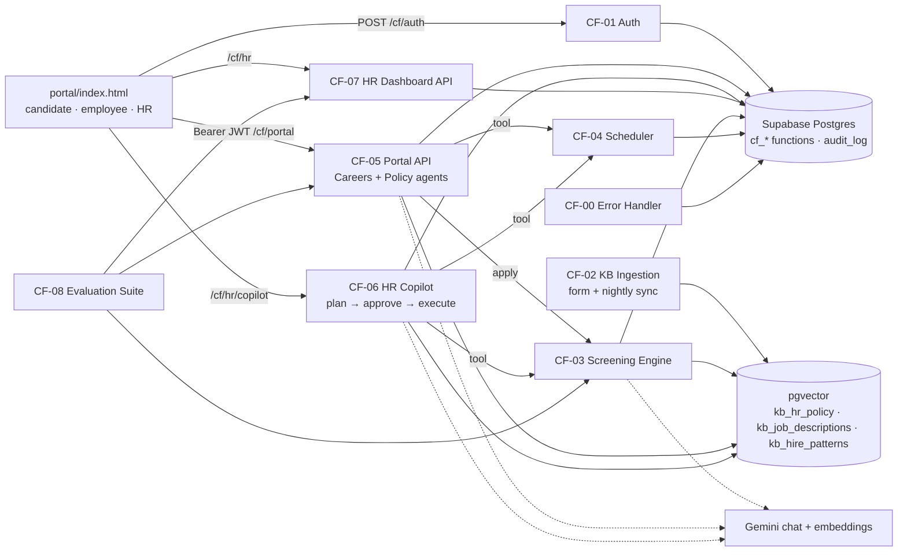

# CompanyFlow — HR & Recruitment Screening Assistant (n8n Cloud)

DEPI · Generative & Agentic AI Systems capstone · Project 05 "HR & Recruitment" (renamed from TawzeefAI) · team of 6.

CompanyFlow screens résumés against real job requirements with **explainable scores**, matches candidates to open
roles, answers employee HR-policy questions from the handbook (RAG), and schedules interviews. It reduces the manual
load on a busy HR team. It is built on **n8n Cloud + Supabase (Postgres + pgvector) + Google Gemini**, with a
role-based web portal.

## Requirements → where they are implemented

| Pillar | Requirement (brief) | Implementation |
|---|---|---|
| Agent | Résumé-to-role matching with real, explainable scoring | CF-03 (redact → LLM extraction → deterministic 7-criterion rubric with evidence) |
| Agent | Interview-scheduling tool | CF-04 (list/book, row locks, Google Calendar + Gmail), used as an agent tool |
| Agent | Memory of each candidate's real status across interactions | `application_events` + live status in the agent prompt + Postgres Chat Memory per user |
| Agent | Real planning for multi-step recruitment workflows | CF-06 HR Copilot: plan → HR approves → execute, with plans stored in `agent_plans` |
| RAG | HR policy & employee handbook | `kb_hr_policy` ← CF-02 upload form; HR Policy Assistant (CF-05) |
| RAG | Real job descriptions & role requirements | `kb_job_descriptions` ← `jobs` table (CF-02 sync) |
| RAG | Anonymised archive of past successful hire patterns | `kb_hire_patterns` ← `hire_patterns` (skills only, no demographics) |
| RAG | Retrieval tuned to distinguish similar but distinct roles | role-header chunks + metadata + "how this role differs" chunk; tested in CF-08 |
| UI | Chat for candidates and employees | `portal/index.html` → Careers assistant / HR Policy Assistant |
| UI | HR dashboard with time-to-hire & screening-volume metrics | Dashboard tab (`cf_hr_dashboard`) |
| UI | Candidate-pipeline visualisation | Pipeline tab (kanban by stage, blind codes, explainable drawer) |
| UI | Role-based views (candidate vs HR) | tabs by role + server-side enforcement |
| Deploy | Real access control | JWT + role allow-lists + scoped tools + SQL ownership checks + Supabase RLS → `docs/ACCESS_CONTROL.md` |
| Deploy | Real secrets management | n8n encrypted credentials only. No secrets in workflows, repo or browser |
| Deploy | Audit logging of every screening decision | append-only, SHA-256 hash-chained `audit_log` |
| Deploy | Error handling for incomplete/malformed résumés | 12 handled cases (see ACCESS_CONTROL §6) + CF-00 error workflow |

Deliverables: screening assistant tested on real roles (CF-08 ranking) · RAG policy Q&A (CF-05 + CF-08 policy QA) ·
dashboard with metrics · documented access control (`docs/ACCESS_CONTROL.md`) · bias write-up (`docs/BIAS_WRITEUP.md`).

## Architecture



## Folder map

```
companyflow/
├── database/01_schema.sql        tables, pgvector tables, cf_* functions, audit chain, RLS lock-down
├── database/02_seed.sql          demo & test users, 6 jobs (3 look-alike pairs), hire patterns, slots, demo history
├── database/03_eval_seed.sql     14 test résumés, 10 ranking cases, 2 fairness pairs, 14 policy questions
├── workflows/CF-00 … CF-08       n8n workflow JSON (import into n8n Cloud)
├── portal/index.html             role-based portal (also has an offline "demo data" mode)
├── knowledge_base/               CompanyFlow_Employee_Handbook.pdf / .md (upload via CF-02 form)
├── test_data/                    résumés (txt + 3 pdf), malformed inputs, ranking cases, policy questions
└── docs/                         ACCESS_CONTROL.md · BIAS_WRITEUP.md
```

## Credentials to create in n8n (use these exact names)

| Name | n8n type | Used by |
|---|---|---|
| `CF Postgres (Supabase)` | Postgres | every workflow, the vector stores and chat memory |
| `CF Gemini API` | Google Gemini (PaLM) API | chat models + embeddings |
| `CF JWT Signing Key` | JWT Auth (passphrase, HS256) | CF-01 sign, CF-05/06/07 verify, CF-08 test tokens |
| `CF HR Forms Login` | Basic Auth | CF-02 upload form, CF-08 baseline form |
| `CF Google Calendar` | Google Calendar OAuth2 | CF-04 (optional) |
| `CF Gmail` | Gmail OAuth2 | CF-04 confirmation, CF-00 alert (optional) |

**After importing:** ① re-select credentials on nodes with a red warning, ② re-select the sub-workflow in
*Run Screening (after reply)*, *interview_slots* (CF-05), *screen_application*, *interview_scheduler* (CF-06) and
*Screen Test Application* (CF-08), ③ set **Settings → Error workflow = CF-00** on CF-01…CF-08, ④ **Publish**
CF-03 and CF-04 first (n8n 2.x calls the *published* version of a sub-workflow), then the rest, ⑤ paste your
production base URL into the portal and into CF-08 *Test Config*.

## API

| Endpoint | Body | Who |
|---|---|---|
| `POST /webhook/cf/auth` | `{action:'login'\|'register', email, password, full_name?}` → `{token, user}` | anyone |
| `POST /webhook/cf/portal` | `{action:'jobs'\|'apply'\|'my_applications'\|'withdraw'\|'chat', …}` | candidate, employee |
| `POST /webhook/cf/hr` | `{action:'dashboard'\|'candidates'\|'application'\|'set_status'\|'audit'\|'verify_audit'\|'generate_slots'\|'eval_runs', …}` | hr |
| `POST /webhook/cf/hr/copilot` | `{mode:'plan'\|'execute'\|'chat', message?, plan_id?}` | hr |
| Form `…/form/cf-kb-upload` | handbook upload | HR (form login) |
| Form `…/form/cf-baseline-timer` | manual-screening timing | HR volunteers |

## Success metrics & how we measure them

| Metric (brief) | How | Where it shows |
|---|---|---|
| Ranks candidates correctly in ≥ 8/10 test cases | CF-08 Ranking: 10 cases × 3 résumés, exact order | Evaluation tab |
| Correctly answers representative HR policy questions | CF-08 Policy QA: 14 questions, deterministic grading | Evaluation tab |
| Zero data leaks between candidate and HR views | CF-08 Leak test: 14 attacks + 1 DB check | Evaluation tab |
| Measured reduction in manual screening time | Baseline form (manual minutes) vs measured automated time + HR review time | Dashboard → "Manual vs CompanyFlow" |
| (extra) No score change from protected attributes | CF-08 Fairness twins | Evaluation tab |

## Verified before hand-off

Everything below ran on **n8n 2.44.4** (the current release) with Postgres 16 + pgvector 0.8, the same layout as
Supabase. Gemini was replaced by a local mock (hand-checked extraction outputs and lexical embeddings), so these
results prove the **plumbing**, not the AI quality.

- All 219 nodes pass n8n's own parameter validation. All 9 workflows import, publish and execute.
- 35/35 API tests: auth, lockout and duplicates, role denials, PDF/TXT/paste apply, scanned/corrupt/Word files,
  plan ownership and single execution.
- Scheduler ownership denial and atomic booking. Error workflow logs PII-free.
- CF-08 offline run: ranking 10/10 · fairness 2/2 · leak 15/15 · retrieval 7/8 (mock embeddings) · policy QA not
  meaningful offline (mock answers). **Re-run CF-08 on n8n Cloud with real Gemini and record those numbers.**
- Scoring logic stress test: 10/10 still pass when the LLM drops skills, role domains or internship flags, misreads
  language levels, hallucinates skills, or misses education fields.

> CompanyFlow, its handbook, people and résumés are fictional test data. Demo passwords in `02_seed.sql` must be
> changed before any real use.
